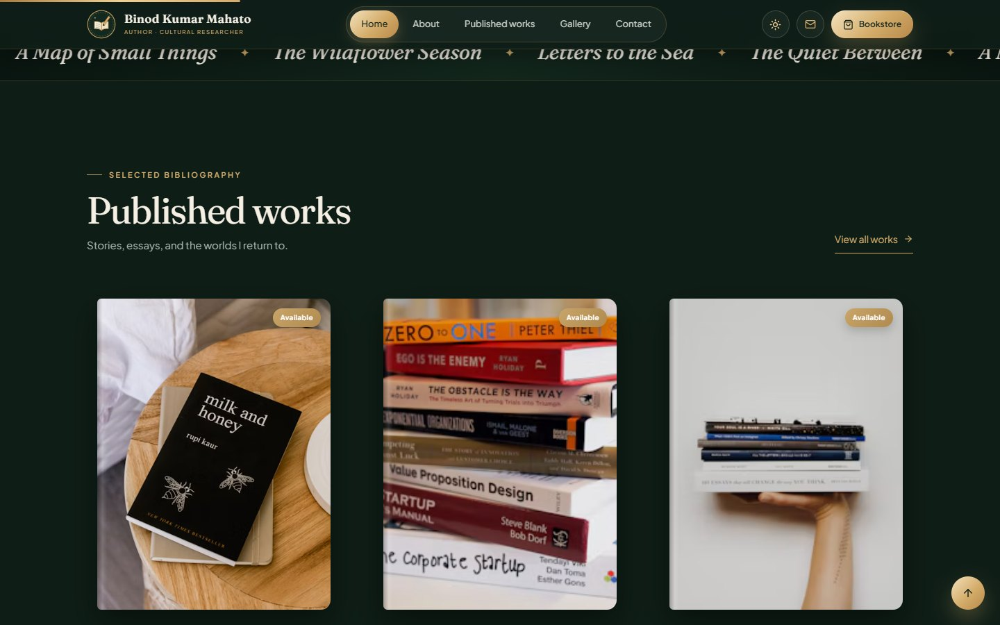
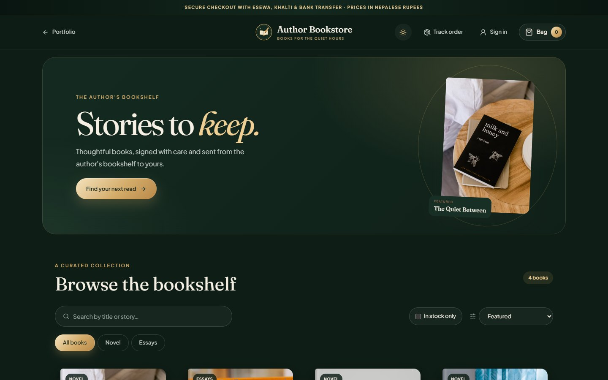
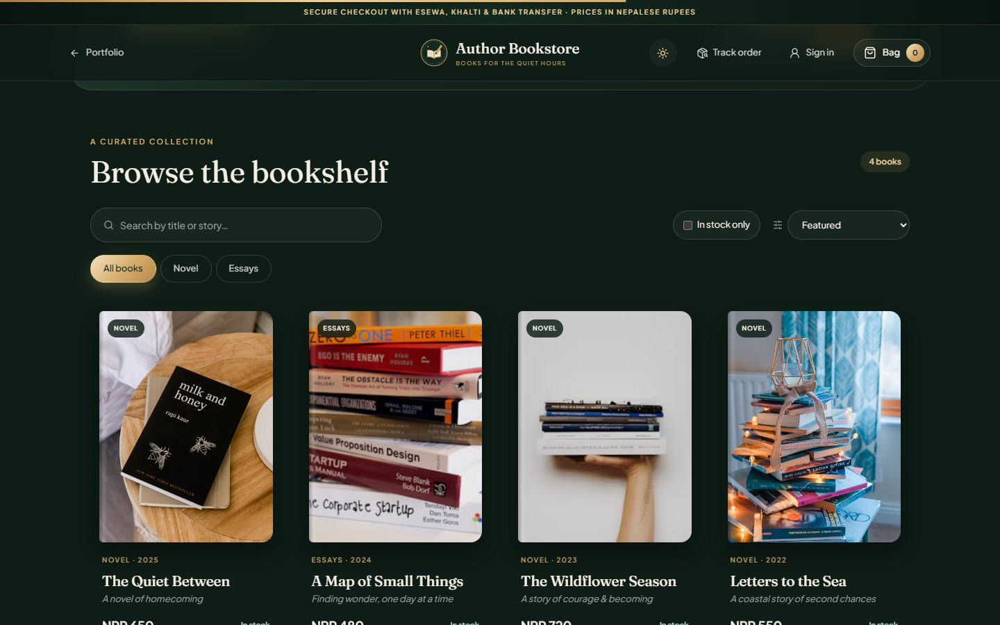
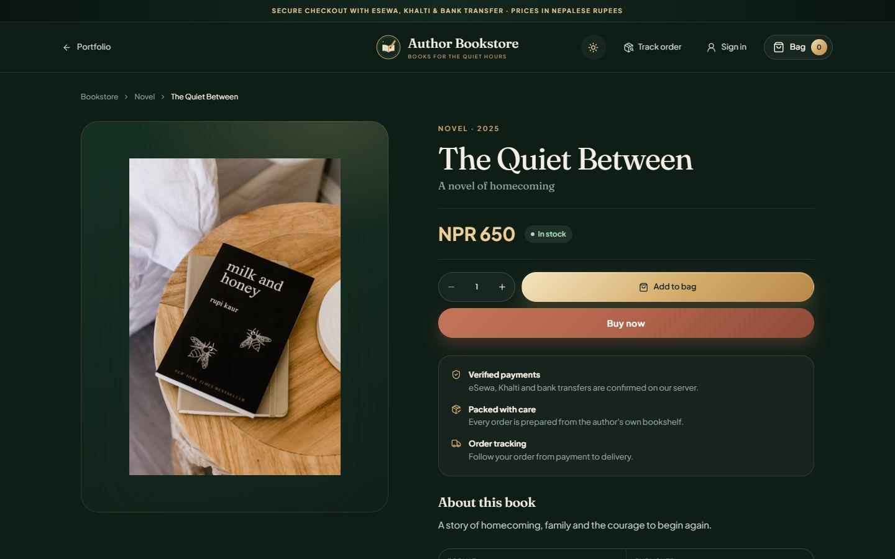
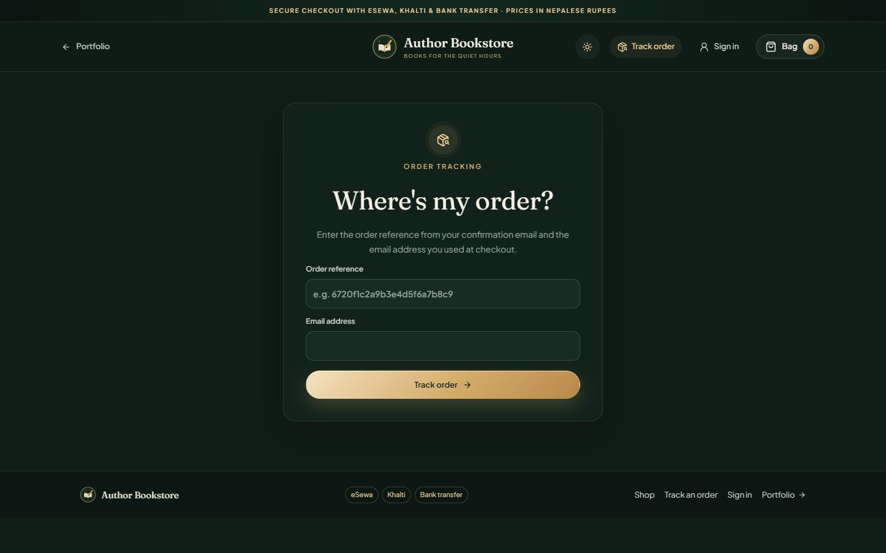
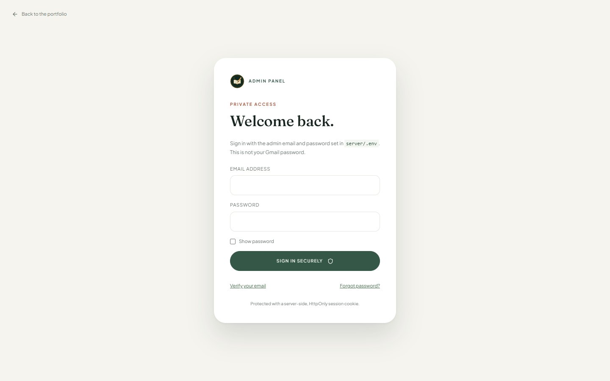
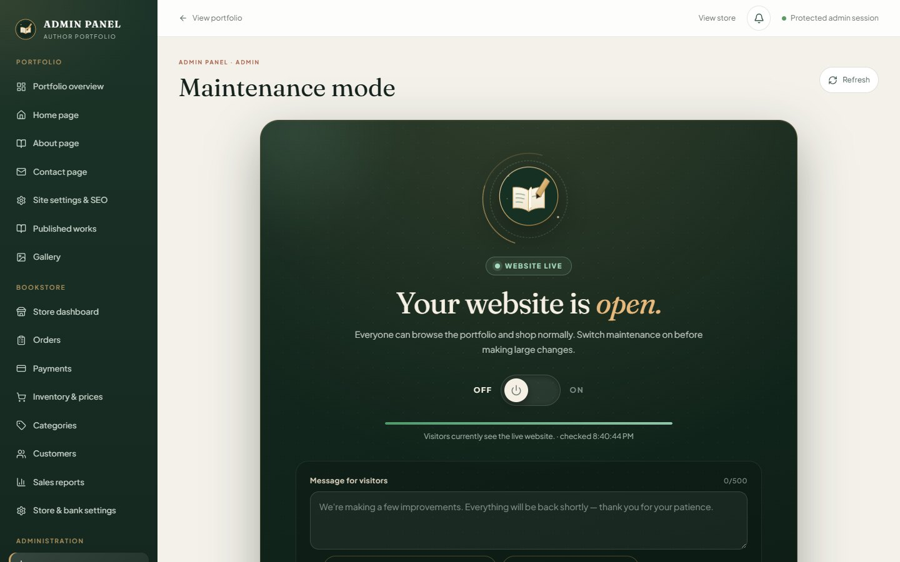
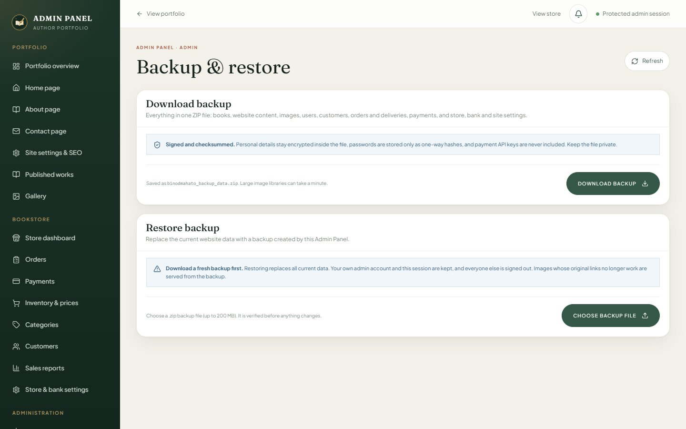

<div align="center">

# Bookstore & Personal Portfolio

**An author portfolio and online bookstore for Nepal, with a full Admin Panel.**
Showcase published works, sell signed copies with eSewa, Khalti or bank transfer, and run the whole site from one secure dashboard.

**[Live demo](#live-demo) · [Screenshots](#screenshots) · [Features](#features) · [Quick start](#quick-start) · [Deployment](#production-deployment)**


</div>

## Live demo

> 🚧 **Coming soon.** The live site has not been deployed yet. This link will be added once it is online.

## Features

### Author portfolio
- Home, About, Published works, Gallery and Contact pages, all editable from the Admin Panel
- Forest-green default theme with a light mode that is remembered per visitor and applied before first paint
- SEO title, description and social-sharing image controlled from **Site settings & SEO**
- Newsletter sign-up with encrypted email storage

### Online bookstore
- Searchable catalogue with categories, sorting and an in-stock filter
- A shareable page for every book, with related titles and SEO metadata
- Shopping bag and two-step checkout in Nepalese rupees (NPR)
- **eSewa**, **Khalti** and **bank transfer** payments, verified on the server, never trusted from the browser
- Order tracking with a progress timeline, shipment carrier and tracking number
- Customer accounts with email verification, saved delivery details and order history

### Admin Panel
- Store dashboard, orders, payments, inventory and prices, categories, customers and sales reports (with CSV export)
- A notification bell for new orders, confirmed payments, reported bank transfers and low stock
- Team roles (`admin`, `manager`, `editor`, `support`) and a searchable activity log
- **Maintenance mode** that takes the public site offline while payments in progress still settle
- **Backup & restore**: one signed `binodmahato_backup_data.zip` with all data and images, with progress tracking and verification before anything changes

### Security
- Argon2id password hashing, HttpOnly session cookies with server-side revocation, rate limiting and origin checks
- Email one-time codes for admin verification and password resets
- Personal details (names, emails, addresses, phone numbers, bank account numbers) encrypted at rest
- Payment secret keys live only in server environment variables, never in the browser or in backups

### Performance
- Self-hosted, preloaded fonts; responsive `srcset` images and lazy loading below the fold
- Gzip-compressed API responses with ETag revalidation (unchanged data returns an empty `304`)
- Admin panels split into on-demand chunks; parallel database queries and indexes on every list

## Screenshots

### Portfolio

| Dark theme (default) | Light theme |
| :---: | :---: |
|  |  |



### Bookstore

| Storefront | Catalogue |
| :---: | :---: |
|  |  |
| **Book page** | **Order tracking** |
|  |  |

### Admin Panel

| Sign in | Maintenance mode |
| :---: | :---: |
|  |  |



### Mobile

<p align="center">
  
  &nbsp;&nbsp;
  
</p>

## Tech stack

| Layer | Technology |
| --- | --- |
| Frontend | Next.js 16 (App Router), React 19, Tailwind CSS, Lucide icons |
| Backend | FastAPI, Uvicorn, PyMongo (async), Pydantic |
| Database | MongoDB (Atlas or self-hosted) |
| Security | Argon2id (pwdlib), PyJWT, Fernet field encryption (cryptography) |
| Payments | eSewa ePay v2, Khalti ePayment, manual bank transfer |
| Email | Any SMTP relay (verification codes and order emails) |

## Project structure

```text
.
├── app/                      Next.js frontend
│   ├── page.jsx              Portfolio (home, about, works, gallery, contact)
│   ├── store/                Bookstore: catalogue, book pages, account, orders, tracking
│   ├── admin/                Admin Panel and its panels (store, maintenance, backup)
│   ├── maintenance/          Maintenance page shown to visitors
│   └── globals.css           Site styles and themes
├── server/                   FastAPI backend
│   ├── main.py               API, security, payments, backup and restore
│   ├── test_main.py          Backend test suite
│   ├── serve.py, run-api.ps1 Start scripts
│   ├── requirements.txt      Python dependencies
│   └── .env.example          Backend configuration template
├── docs/screenshots/         Images used in this README
├── proxy.js                  Maintenance-mode gate for public pages
├── next.config.mjs           Next.js config and /api proxy
└── .env.local.example        Frontend configuration template
```

## Quick start

**Requirements:** Node.js 20.9+, Python 3.11+, and a MongoDB database (local MongoDB Community Server or a free MongoDB Atlas cluster).

```powershell
git clone https://github.com/bikash880/Bookstore-Personal-Portfolio.git
cd Bookstore-Personal-Portfolio
npm install
Copy-Item .env.local.example .env.local
Copy-Item server/.env.example server/.env
```

Edit `server/.env` (see [Configuration](#configuration)), then start the two services in separate terminals:

```powershell
# Terminal 1: website on http://localhost:3000
npm run dev

# Terminal 2: API on http://127.0.0.1:4000
npm run api
```

`npm run api` finds Python 3.11+, installs `server/requirements.txt` if needed, and starts Uvicorn. On first start the API creates the administrator account and seeds four sample books. Sign in at **http://localhost:3000/admin**. Interactive API docs are at `/api/docs` in development.

Run the backend tests with:

```powershell
npm run check --prefix server
```

## Configuration

Every secret stays in `server/.env`, which Git ignores. Only the `.example` templates are committed.

| Variable | Purpose |
| --- | --- |
| `APP_ENV` | `development` locally, `production` when deployed |
| `MONGODB_URI`, `MONGODB_DATABASE` | Database connection (use TLS in production) |
| `JWT_SECRET`, `DATA_ENCRYPTION_KEY`, `EMAIL_INDEX_SECRET` | Three different random secrets of 32+ characters. **Never change the last two** without migrating data. Backups only restore with the same values |
| `ADMIN_EMAIL`, `ADMIN_PASSWORD` | Bootstrap administrator (password of 12+ characters, used only on first creation) |
| `FRONTEND_URL`, `PUBLIC_WEBSITE_URL`, `API_PUBLIC_URL`, `API_ALLOWED_ORIGINS` | Public origins (exact HTTPS origins in production) |
| `SMTP_HOST`, `SMTP_PORT`, `SMTP_SECURITY`, `SMTP_FROM`, `SMTP_USERNAME`, `SMTP_PASSWORD` | Mail relay for verification codes and order emails |
| `ESEWA_MODE`, `ESEWA_*_PRODUCT_CODE`, `ESEWA_*_SECRET_KEY` | eSewa test or live credentials |
| `KHALTI_MODE`, `KHALTI_*_SECRET_KEY` | Khalti test or live credentials |

The frontend's `.env.local` needs only `API_SERVER_URL` (default `http://127.0.0.1:4000`). Leave `NEXT_PUBLIC_API_URL` empty so the browser reaches the API through the built-in same-origin `/api` proxy, which keeps session cookies first-party.

<details>
<summary><strong>SMTP tips (Gmail, Google Workspace)</strong></summary>

- Use a dedicated relay. Never use your main Google account password.
- For a personal Gmail mailbox, use `smtp.gmail.com`, port `587`, `starttls`, and a Google **App Password**.
- For Google Workspace SMTP Relay, use the host and authentication method your Workspace administrator authorized. If the relay allowlists IP addresses instead, add the API server's public IP and leave `SMTP_USERNAME` and `SMTP_PASSWORD` empty.
- `550 5.7.0 Mail relay denied` means the relay rejects the sender domain or the server's IP. Authorize them in the Workspace Admin console.
- Restart the API after editing `server/.env`. Admin verification and password reset show which setting is missing when mail can't be sent.
</details>

## How it works

<details>
<summary><strong>Admin Panel and roles</strong></summary>

Only the email in `ADMIN_EMAIL` can sign in to `/admin`. The account must verify that address with a one-time email code first. **Forgot password?** sends a 10-minute, single-use reset code and signs out every session. Changing `ADMIN_EMAIL` updates the bootstrap account on the next API start, clears its verification and revokes its sessions.

Admin APIs re-check the user, role and session on every request, enforce origin checks on writes, validate fields and record an activity log. Store, order, payment and customer endpoints are limited to the administrator. Editors and managers keep portfolio permissions only.
</details>

<details>
<summary><strong>Bookstore, payments and orders</strong></summary>

A published work appears in the store once it has a category, a positive NPR price and stock (set under **Inventory & prices**). Checkout reserves stock on the server and calculates totals from the database.

- **eSewa and Khalti:** sessions start on the server, and an order is marked paid only after the provider confirms the payment. Use test credentials (`*_MODE=test`) until you go live; live mode needs public HTTPS URLs the providers can call back.
- **Bank transfer:** enabled once the bank name, account holder and account number are saved under **Store & bank settings**. Orders stay pending until the administrator checks the statement and confirms the payment. Customers can report their transfer reference, which notifies the administrator but never marks the order paid.
- **Fulfilment:** paid → processing → shipped (carrier and tracking number) → delivered. Cancelling a paid order restocks it and flags a refund until **Record refund**. Customers receive status emails.
- **Tracking:** `/store/track` reopens an order with its reference and checkout email.
</details>

<details>
<summary><strong>Customer accounts</strong></summary>

Shoppers register at `/store/account` and verify their email with a 6-digit code. Signed-in customers get pre-filled checkout and their order history, and earlier guest orders with the same email are attached after verification. The administrator can suspend or reactivate accounts under **Customers → Registered accounts**. Customer sessions never grant Admin Panel access.
</details>

<details>
<summary><strong>Maintenance mode</strong></summary>

When maintenance mode is ON, every public page returns a maintenance page with HTTP `503` (so search engines don't index it), and the public API refuses orders and sign-ins. The Admin Panel, health checks and eSewa/Khalti callbacks stay available, so payments in progress still settle. You can set a message and an "expected back" time, which visitors see as a countdown. If the status can't be read, the site stays online rather than locking visitors out.
</details>

<details>
<summary><strong>Backup &amp; restore</strong></summary>

**Download backup** creates `binodmahato_backup_data.zip`, which contains:

- every database collection (users, books, orders and deliveries, payments, customers, categories, website content, gallery, store, bank and site settings, newsletter, notifications, activity log) in MongoDB Extended JSON;
- copies of all book-cover, gallery and website images;
- a `manifest.json` with SHA-256 checksums, signed with HMAC.

Login sessions and secret keys are never included. Personal details stay encrypted, and passwords exist only as one-way hashes. Keep the file private anyway.

**Restore backup** checks the file in the browser (a real ZIP of 200 MB or less), then on the server: file allow-list (blocks path traversal), zip-bomb limits, signature, every checksum and every record. Only then does it show what the backup contains. Restoring requires typing `RESTORE`. It replaces all data, keeps the signed-in administrator, signs everyone else out, and rolls back automatically if anything fails. Images whose original links no longer work are served from the backup copy.

Backups restore only on a server with the same `DATA_ENCRYPTION_KEY` and `EMAIL_INDEX_SECRET`, so store those secrets safely alongside your backups.
</details>

<details>
<summary><strong>API overview</strong></summary>

| Area | Endpoints |
| --- | --- |
| Public reads | `GET /api/books`, `/api/gallery`, `/api/content`, `/api/store/books`, `/api/store/books/:id`, `/api/store/settings`, `/api/site/status` |
| Checkout | `POST /api/payments/nepal/esewa/initiate`, `/api/payments/nepal/khalti/initiate`, `/api/orders/bank-transfer` |
| Orders | `POST /api/orders/lookup`, `GET /api/payments/nepal/track/:orderId`, `POST /api/payments/nepal/track/:orderId/bank-reference` |
| Customers | `/api/auth/register`, `/verify-email`, `/login`, `/logout`, `/password/request`, `/password/reset`, `GET /api/auth/me`, `/api/account/orders`, `/api/account/profile`, `/api/account/password` |
| Admin | Everything under `/api/admin`: auth, books, orders, payments, customers, accounts, categories, settings, content, media, analytics, notifications, maintenance, backup |
| Health | `GET /health/live`, `GET /health/ready` |
</details>

## Production deployment

The app is not tied to any domain or hosting provider. Keep real secrets in your hosts' secret managers, never in the repository.

1. **Database:** provision MongoDB with TLS, authentication, backups, and network access limited to the API host. Set `MONGODB_URI` and `MONGODB_DATABASE`.
2. **Origins:** set `APP_ENV=production`, `FRONTEND_URL`, `PUBLIC_WEBSITE_URL`, `API_PUBLIC_URL` and `API_ALLOWED_ORIGINS` to exact HTTPS origins. The API refuses to start if domains, database TLS, SMTP or secrets are invalid.
3. **Secrets:** generate three different 32+ character secrets for `JWT_SECRET`, `DATA_ENCRYPTION_KEY` and `EMAIL_INDEX_SECRET`, and back up the last two. Set `ADMIN_EMAIL` and `ADMIN_PASSWORD`.
4. **Email:** configure the SMTP relay. Admin verification and password reset depend on it.
5. **API host:** install `server/requirements.txt` and run `python serve.py start` from `server/` behind HTTPS. Point health probes at `/health/live` (process) and `/health/ready` (database). Behind a reverse proxy, set `FORWARDED_ALLOW_IPS` to the proxy's IPs only. The rate limiter is per process, so use a shared limiter for multi-instance deployments.
6. **Frontend:** for the same origin, leave `NEXT_PUBLIC_API_URL` empty and set `API_SERVER_URL`. For a separate API domain, set `NEXT_PUBLIC_API_URL` to its public HTTPS origin before building (and `SESSION_COOKIE_SAMESITE=none` if the domains are cross-site). Then run `npm run build` and `npm start`.
7. **Payments:** switch `ESEWA_MODE` and `KHALTI_MODE` to `live` with live credentials once the public URLs work.
8. **Check:** the website, `/admin` sign-in and email verification, health endpoints, a test order, and a backup download.

Images are managed as HTTPS URLs. Host them on a persistent CDN or object store (for example Cloudinary), not on the server's disk.

## License

Released under the [MIT License](LICENSE).
